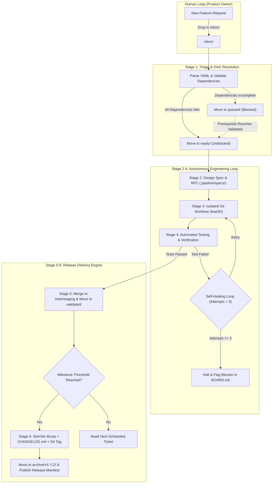
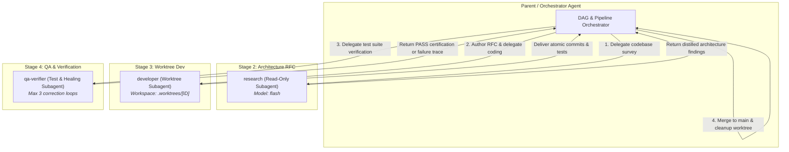

# 🛠️ Autonomous Continuous Development Guidelines & Process Proposal
**Framework: ACDO (Autonomous Continuous Development Organization)**  
**Version:** 1.0.0  
**Target:** Multi-Project Continuous AI Engineering & Release Pipeline

---

## 1. Executive Summary & Philosophy

This guideline defines a production-ready operating system for paired human-AI software engineering. It decouples **Product Ownership** (you continuously pushing feature requests, user stories, and bug reports) from **Autonomous Implementation** (the AI agent triaging, resolving ticket dependencies, designing technical specs, coding in isolated worktrees, verifying tests, and cutting semantic releases).

### Core Tenets
1. **Zero Working-Tree Disruption**: Background development *never* touches your active checkout. All work occurs in ephemeral, isolated Git worktrees.
2. **Deterministic Dependency Graph (DAG)**: Tickets with prerequisites (`depends_on`) remain locked until dependencies pass verification and are integrated.
3. **Atomic Contexts & Token Discipline**: Avoid long-running unbounded sessions. Every ticket runs in an atomic execution cycle with bounded steps to prevent context window bloat and runaway token consumption.
4. **Autonomous Quality Gates**: Code is never merged without passing automated test suites, linting, and type verification. If tests fail, the agent executes up to 3 self-healing debug loops before flagging for human intervention.
5. **Continuous SemVer Delivery**: Completed features are automatically aggregated into release candidates, version-bumped, documented in `CHANGELOG.md`, and tagged in Git.

---

## 2. Directory & Repository Architecture

We implement a **Hybrid Topology**:
* **Central Control Plane** (`/home/laurent/Dev/app-factory/guidelines`): Houses the overarching guidelines, ticket schemas, execution scripts, and cross-project tooling.
* **Per-Project Pipeline** (`<project-root>/.pipeline/`): Houses the project's active ticket state machine, design RFCs, and release manifests.

```
/home/laurent/Dev/app-factory/
├── guidelines/                    # Central Engineering Control Plane
│   ├── GUIDELINES.md              # This document
│   ├── templates/                 # Standard templates
│   │   ├── ticket.md              # Feature / bug ticket template
│   │   ├── rfc.md                 # Design & Architecture RFC template
│   │   └── release.md             # Release notes manifest template
│   └── .gemini/
│       └── rules.md               # Autonomous agent execution directives
│
└── <target-project>/              # Any repo (100% self-contained & portable)
    ├── AGENTS.md                  # Project agent directives (relative links)
    ├── GEMINI.md -> AGENTS.md     # Symlink for native Antigravity discovery
    ├── .pipeline/
    │   ├── GUIDELINES.md          # Embedded runbook copy
    │   ├── templates/             # Embedded ticket.md, rfc.md, and release.md templates
    │   ├── config.json            # Build/test commands, branch names, token budget
    │   ├── tickets/
    │   │   ├── inbox/             # Drop new tickets here anytime
    │   │   ├── queued/            # Triaged, blocked waiting on dependencies
    │   │   ├── ready/             # Unblocked, ready for autonomous execution
    │   │   ├── active/            # Currently being developed or tested
    │   │   ├── validated/         # Passed tests, merged to staging/main
    │   │   └── archive/           # Released tickets grouped by version (v1.0.0, etc.)
    │   ├── specs/                 # Technical RFCs generated for active tickets
    │   ├── releases/              # Generated release candidate records
    │   └── BOARD.md               # Living Kanban & DAG status dashboard
    ├── src/
    ├── tests/
    └── CHANGELOG.md
```

---

## 3. Ticket Specification & Dependency Schema

All feature requests are authored as lightweight Markdown files with YAML frontmatter. This allows you to write requests quickly in any text editor, while providing the agent with machine-parseable constraints.

### Ticket Metadata Schema

| Field | Type | Description |
| :--- | :--- | :--- |
| `id` | String | Unique ticket ID (e.g. `FEAT-101`, `BUG-042`, `CORE-015`). |
| `project` | String | Identifier matching target folder name. |
| `title` | String | Short, descriptive title. |
| `type` | Enum | `feature` \| `bug` \| `refactor` \| `chore` \| `perf` |
| `priority` | Enum | `critical` \| `high` \| `medium` \| `low` |
| `target_version`| String | Target release milestone (`v1.2.0`, `patch`, `minor`, `major`). |
| `depends_on` | List | IDs of prerequisite tickets that must be in `validated` or `archive`. |
| `blocks` | List | IDs of tickets waiting on this ticket. |
| `max_steps` | Integer | Hard token/tool step limit for the agent (Default: `10`). |
| `autonomous` | Boolean | `true` (auto-merge on pass) \| `false` (halt after RFC for review). |

### Ticket Example: `.pipeline/tickets/inbox/FEAT-088-weapon-cooldown.md`

```yaml
---
id: FEAT-088
project: kan-shooter
title: Implement Dynamic Weapon Cooldown & Overheat Mechanic
type: feature
priority: high
target_version: minor
depends_on:
  - CORE-012               # Weapon inventory data structures
blocks:
  - FEAT-092               # UI overheat gauge hud
max_steps: 12
autonomous: true
---

## 1. Objective
Introduce an overheat gauge and cooldown curve to energy weapons to balance high-rate-of-fire weapons.

## 2. Technical Requirements
- Add `heat` (0.0 to 1.0) and `cooling_rate` properties to `WeaponConfig`.
- If `heat >= 1.0`, trigger `Overheated` state preventing firing for 2.5 seconds.
- Provide signals: `heat_changed(current_heat)` and `weapon_overheated()`.

## 3. Acceptance Criteria
- [ ] Unit tests confirm heat accumulates on fire and decays during idle frames.
- [ ] Firing while overheated is strictly rejected.
- [ ] Test coverage for overheat recovery time is verified.
- [ ] Zero regression in existing projectile collision tests.
```

---

## 4. The 6-Stage Autonomous Engineering Process



### Stage 1: Triage & DAG Dependency Resolution
* The agent scans `.pipeline/tickets/inbox/`.
* For each ticket, it inspects `depends_on`.
* If any dependency is **not** yet in `validated/` or `archive/`, the ticket is moved to `queued/`.
* If all dependencies are satisfied, the ticket is promoted to `ready/`.
* `BOARD.md` is updated with the current status tree and dependency graph.
* **Git Operations (Main Branch)**:
  ```bash
  git add .pipeline/tickets/ .pipeline/BOARD.md
  git commit -m "chore(pipeline): triage inbox tickets and update DAG"
  ```

### Stage 2: Architecture & Design RFC (The Ambiguity Gate)
* Before modifying production code, the agent creates `.pipeline/specs/[ID]-rfc.md`.
* The RFC outlines:
  1. Files to be created or modified.
  2. Interface contracts and data structures.
  3. Adherence to project guidelines (e.g. `guidelines/vuejs.md`, `videogames.md`).
  4. Specific test scenarios for acceptance criteria.
* The ticket is moved from `ready/` to `active/`, and both the ticket state and RFC are recorded on the primary branch:
  ```bash
  git add .pipeline/tickets/active/[ID]-*.md .pipeline/BOARD.md
  git commit -m "chore(pipeline): start active development on [ID]"
  git add .pipeline/specs/[ID]-rfc.md
  git commit -m "docs(specs): add [ID] technical design RFC"
  ```

#### 🚨 What Happens If Something Is Unclear? (Ambiguity Protocol)
If a ticket contains vague requirements, missing credentials, or architectural forks:

1. **Minor / Implementation Detail (Tier 1)**:
   * *Example:* Internal helper function naming, exact private method decomposition.
   * *Action:* The agent makes an educated, idiomatic decision adhering strictly to existing project conventions, logs the rationale under `## Architectural Decisions` in the RFC, and proceeds autonomously.

2. **Major / Functional or Architectural Ambiguity (Tier 2)**:
   * *Example:* Missing product business logic, conflicting acceptance criteria, UX trade-off choices, or missing external API keys.
   * *Action (Quarantine & Skip, Don't Guess)*:
     1. **Never guess or hallucinate**: Guessing wastes tokens and risks writing disposable code.
     2. **Quarantine Ticket**: The ticket is tagged `BLOCKED_NEED_INFO` and moved to `queued/`.
     3. **Emit Clarification RFC**: The agent writes `.pipeline/specs/[ID]-question.md` outlining the exact ambiguity and proposing 2–3 concrete options with pros/cons.
     4. **Update `BOARD.md`**: Posts an alert under `## ⚠️ Blocked / Needs Clarification`.
     5. **Commit Quarantine State**:
        ```bash
        git add .pipeline/specs/[ID]-question.md .pipeline/tickets/ .pipeline/BOARD.md
        git commit -m "docs(specs): quarantine [ID] pending user clarification"
        ```
     6. **Continuous Progression**: The agent **does not halt the entire `/goal` run**. It automatically moves on to the next independent unblocked ticket in `ready/`.
     7. **Report to User**: At the end of the sprint, the agent alerts you to the exact question needing your input.
* If `autonomous: false` was set on the ticket, the agent pauses after writing the RFC and waits for your sign-off before coding. Otherwise, it proceeds directly to Stage 3.

### Stage 3: Isolated Worktree Development
* The agent never modifies the user's active checkout directly.
* Spawns an isolated Git worktree linked to a dedicated feature branch:
  ```bash
  # Pre-flight check: ensure clean repository and branch does not collide
  git status --porcelain
  git branch --list feat/[ID]

  # Provision ephemeral worktree and create feature branch from HEAD
  git worktree add -b feat/[ID] .worktrees/[ID] HEAD

  # Switch execution directory to the worktree
  cd .worktrees/[ID]
  ```
* Implementation is executed strictly within this isolated directory.
* Commits are made incrementally adhering to **Conventional Commits**:
  ```bash
  git status -s
  git add src/ tests/
  git commit -m "feat(weapons): implement heat accumulation logic [[ID]]"
  ```

### Stage 4: Continuous Automated Testing & Self-Healing
* The agent executes test scripts defined in `.pipeline/config.json`:
  ```bash
  npm test # or pytest / cargo test / godot --test
  ```
* **Self-Healing Protocol**:
  * If a test fails, the agent parses the stack trace and diff (`git diff`).
  * It corrects the code in the worktree, verifies tests, and commits fixes:
    ```bash
    git add <modified-files>
    git commit -m "fix(weapons): resolve overheat cooldown edge case [[ID]]"
    ```
  * Up to **3 correction attempts** are permitted.
  * If a fix attempt fails and must be rolled back:
    ```bash
    git restore . && git clean -fd
    ```
  * If still failing after 3 attempts, the agent halts without merging:
    - Leaves `feat/[ID]` intact for developer review.
    - Removes the worktree directory: `cd <project-root> && git worktree remove --force .worktrees/[ID] && git worktree prune`.
    - Marks the ticket as `stalled` in `BOARD.md` and commits the failure report on `main`.

### Stage 5: Integration & Staging
* Once all tests, linters, and type-checks pass cleanly:
  1. Confirm clean worktree state:
     ```bash
     git status --porcelain
     ```
  2. Return to project root and ensure primary branch is checked out:
     ```bash
     cd <project-root>
     git checkout main
     ```
  3. Non-fast-forward merge to preserve atomic ticket provenance and commit history:
     ```bash
     git merge --no-ff feat/[ID] -m "feat(weapons): merge dynamic weapon cooldown [[ID]]"
     ```
  4. Decommission ephemeral worktree and prune Git metadata:
     ```bash
     git worktree remove .worktrees/[ID]
     git worktree prune
     ```
  5. Delete merged local feature branch:
     ```bash
     git branch -d feat/[ID]
     ```
  6. Record ticket validation in pipeline state on `main`:
     ```bash
     mv .pipeline/tickets/active/[ID]-*.md .pipeline/tickets/validated/
     git add .pipeline/tickets/ .pipeline/BOARD.md
     git commit -m "chore(pipeline): record [ID] as validated"
     ```
  7. Downstream tickets in `queued/` waiting on `[ID]` are re-evaluated and promoted to `ready/`.

### Stage 6: Release Delivery & Version Management
* When a target release milestone is reached (e.g., all tickets for `v1.2.0` reach `validated/`):
  1. **SemVer Calculation**: Calculates next version (`patch`, `minor`, `major`) based on conventional commit types.
  2. **CHANGELOG Automation**: Appends a new section in `CHANGELOG.md` categorizing Features, Fixes, and Performance.
  3. **Release Manifest & Ticket Archival**:
     - Moves validated tickets: `mv .pipeline/tickets/validated/*.md .pipeline/tickets/archive/v1.2.0/`.
     - Generates `.pipeline/releases/RELEASE-v1.2.0.md`.
  4. **Release Commit**:
     ```bash
     git add CHANGELOG.md package.json .pipeline/tickets/archive/ .pipeline/releases/
     git commit -m "chore(release): cut v1.2.0"
     ```
  5. **Annotated Git Tag**:
     ```bash
     git tag -a v1.2.0 -m "Release v1.2.0"
     ```
  6. **Upstream Push** (when remote repository is configured):
     ```bash
     git push origin main --tags
     ```

---

## 5. Detailed Git Execution & Repository Management Protocol

This section specifies the complete runbook of Git commands executed by the autonomous agent to manage repositories safely, predictably, and without disrupting the developer.

### 5.1 Architecture & Ephemeral Worktree Topology

```
<project-root>/                           (Branch: main - Human checkout / Pipeline control)
├── .git/
├── .gitignore                            (Must include: .worktrees/)
├── .pipeline/                            (Living ticket state machine & specs)
└── .worktrees/
    └── FEAT-088/                         (Branch: feat/FEAT-088 - Isolated AI worktree)
        ├── src/
        ├── tests/
        └── package.json
```

* **Zero-Pollution Guarantee**: The AI agent never creates feature branches directly inside `<project-root>` or switches the developer's working directory.
* **Physical Isolation**: All code writing, dependency tests, and experimental edits run inside `.worktrees/<ID>`.
* **State Decoupling**: `.pipeline/` state transitions (triage, RFC specs, validation markers) are tracked directly on `main`, while code changes reside on `feat/<ID>`.

---

### 5.2 Repository Pre-Flight Verification Runbook

Before selecting or executing any ticket, the agent performs a pre-flight sanity check on `<project-root>`:

```bash
# 1. Verify that the primary working copy is clean (no uncommitted edits)
git status --porcelain

# 2. Verify that HEAD is pointing to the designated main branch
git rev-parse --abbrev-ref HEAD
# Expected output: main (or master)

# 3. Clean up any stale or orphaned worktree references left by interrupted runs
git worktree prune

# 4. List all active worktrees to verify no active collision
git worktree list

# 5. Fetch latest upstream changes (if remote is configured)
git rev-parse --is-inside-work-tree >/dev/null 2>&1
git remote -v | grep -q origin && git fetch origin main || true
```

---

### 5.3 Stage-by-Stage Git Execution Walkthrough

#### Step 1: Initializing Project Pipeline (Run Once)
Scaffolding executed by `init-pipeline.sh` or the agent during first setup:

```bash
# Initialize repo if not already a git repository
git init -b main

# Ensure .worktrees/ is excluded from version control
grep -q "^\.worktrees/" .gitignore 2>/dev/null || echo -e "\n# ACDO Autonomous Worktrees\n.worktrees/\n" >> .gitignore

# Ensure at least one initial commit exists (worktrees require a valid HEAD commit)
if ! git rev-parse --verify HEAD >/dev/null 2>&1; then
    git add .gitignore
    git commit -m "chore: initial project scaffolding"
fi
```

#### Step 2: Inception & RFC State Commits (Working Dir: `<project-root>`, Branch: `main`)
When the agent promotes a ticket to `active` and generates its architecture RFC:

```bash
# Move ticket from ready/ to active/
mv .pipeline/tickets/ready/<ID>-<slug>.md .pipeline/tickets/active/<ID>-<slug>.md

# Commit the active state transition to main
git add .pipeline/tickets/active/<ID>-<slug>.md .pipeline/BOARD.md
git commit -m "chore(pipeline): start active development on <ID>"

# Author and commit the technical RFC specification
# (File written: .pipeline/specs/<ID>-rfc.md)
git add .pipeline/specs/<ID>-rfc.md
git commit -m "docs(specs): add <ID> technical design RFC"
```

#### Step 3: Worktree Provisioning & Branch Creation (Working Dir: `<project-root>`)
The agent creates an isolated branch and worktree:

```bash
# Check if branch name already exists from an earlier attempt
if git show-ref --quiet refs/heads/feat/<ID>; then
    echo "Branch feat/<ID> already exists. Inspecting status..."
fi

# Create worktree and branch from HEAD
git worktree add -b feat/<ID> .worktrees/<ID> HEAD

# Verify worktree creation
git worktree list | grep "<ID>"
```

#### Step 4: Development & Conventional Commits (Working Dir: `.worktrees/<ID>`, Branch: `feat/<ID>`)
All code modifications, new files, and tests are performed exclusively within `.worktrees/<ID>`:

```bash
cd .worktrees/<ID>

# Verify active worktree branch
git rev-parse --abbrev-ref HEAD
# Expected output: feat/<ID>

# Stage files cleanly (avoiding accidental temporary files or node_modules)
git add src/path/to/modified_file.js
git add tests/path/to/new_test.js

# Review staged changes
git diff --staged --stat

# Commit following Conventional Commits format
git commit -m "<type>(<scope>): <concise description> [<ID>]"
# Example: git commit -m "feat(controls): dynamic player movement speed via mouse wheel [FEAT-001]"
```

#### Step 5: Test Verification & Self-Healing Commit Loops (Working Dir: `.worktrees/<ID>`)
During Stage 4 automated testing:

```bash
# Run configured test runner
npm test # or pytest / cargo test

# --- CASE A: Tests Pass Immediately ---
# Proceed directly to Step 6.

# --- CASE B: Test Fails -> Self-Healing Loop (Up to 3 attempts) ---
# Inspect failure diff
git diff

# Make code correction, then stage and commit the fix
git add src/path/to/fix.js
git commit -m "fix(<scope>): resolve test assertion failure [<ID>]"

# --- CASE C: Experimental Fix Failed (Discard and Re-attempt) ---
# Discard unstaged changes:
git restore .
# Clean untracked scratch files:
git clean -fd
# Discard the last invalid commit if needed:
git reset --hard HEAD~1
```

#### Step 6: Integration, Non-Fast-Forward Merge & Teardown (Working Dir: `<project-root>`)
Once all quality gates pass (tests, linters, static build):

```bash
# 1. Verify worktree is completely clean
cd .worktrees/<ID>
if [ -n "$(git status --porcelain)" ]; then
    echo "ERROR: Uncommitted changes detected in worktree!"
    exit 1
fi

# 2. Return to project root and ensure primary branch
cd <project-root>
git checkout main

# 3. Pull latest main if remote exists
git remote -v | grep -q origin && git pull --ff-only origin main || true

# 4. Check if main moved ahead; if so, rebase feature branch inside worktree
if ! git merge-base --is-ancestor main feat/<ID>; then
    echo "Main has advanced. Rebasing feature branch..."
    (cd .worktrees/<ID> && git rebase main)
fi

# 5. Execute Non-Fast-Forward merge to record explicit merge commit with ticket ID
git merge --no-ff feat/<ID> -m "feat(<scope>): merge <ticket-title> [<ID>]"

# 6. Decommission the worktree directory and prune git metadata
git worktree remove .worktrees/<ID>
git worktree prune

# 7. Delete the local feature branch
git branch -d feat/<ID>

# 8. Promote ticket to validated and update pipeline board on main
mv .pipeline/tickets/active/<ID>-<slug>.md .pipeline/tickets/validated/<ID>-<slug>.md
git add .pipeline/tickets/ .pipeline/BOARD.md
git commit -m "chore(pipeline): record <ID> as validated"
```

#### Step 7: SemVer Milestone Release & Tagging (Working Dir: `<project-root>`, Branch: `main`)
When milestone criteria are met:

```bash
# 1. Update version, CHANGELOG.md, and archive tickets
# (mv .pipeline/tickets/validated/*.md .pipeline/tickets/archive/vX.Y.Z/)
# (generate .pipeline/releases/RELEASE-vX.Y.Z.md)

# 2. Stage all release artifacts
git add CHANGELOG.md package.json .pipeline/tickets/archive/ .pipeline/releases/

# 3. Create release commit
git commit -m "chore(release): cut vX.Y.Z"

# 4. Create annotated Git tag
git tag -a vX.Y.Z -m "Release vX.Y.Z"

# 5. Verify tag creation
git tag -l -n1 "vX.Y.Z"

# 6. Push release and tags to remote (if configured)
git remote -v | grep -q origin && git push origin main --tags || true
```

---

### 5.4 Error Recovery, Rollback & Fault-Tolerance Protocols

#### Protocol A: Self-Healing Exhaustion (3 Failed Test Attempts)
When verification fails after 3 self-healing loops, the agent must never corrupt `main`:

```bash
# 1. Return to project root
cd <project-root>

# 2. Preserve feat/<ID> branch for human inspection, but remove the worktree directory
git worktree remove --force .worktrees/<ID>
git worktree prune

# 3. Move ticket to queued/ with BLOCKED status and record in BOARD.md
# (Update .pipeline/tickets/active/<ID>-<slug>.md -> queued/<ID>-<slug>.md)
git add .pipeline/tickets/ .pipeline/BOARD.md
git commit -m "chore(pipeline): mark <ID> as stalled after failed verification"

# Note: The branch feat/<ID> remains accessible via git checkout feat/<ID> for debugging.
```

#### Protocol B: Merge Conflict on Integration
If a merge conflict occurs during `git merge --no-ff`:

```bash
# 1. Immediately abort the merge
git merge --abort

# 2. Do not delete worktree or branch
# 3. Log conflict details in BOARD.md under ## ⚠️ Blocked
git add .pipeline/BOARD.md
git commit -m "chore(pipeline): flag merge conflict on <ID>"
```

#### Protocol C: Orphaned Worktree or Stale Lock Recovery
If an interrupted process leaves stale lock files or orphaned worktree entries:

```bash
# Discover all worktrees known to git
git worktree list

# Force clean any dangling worktree entry whose directory was removed
git worktree prune -v

# If a worktree directory is stuck and needs removal:
git worktree remove --force .worktrees/<stale-id> 2>/dev/null || rm -rf .worktrees/<stale-id>
git worktree prune
```

---

### 5.5 Master Git Command Reference Matrix

| Lifecycle Stage | Working Dir (`CWD`) | Command Line | Intent / Precondition | On Failure / Rollback |
| :--- | :--- | :--- | :--- | :--- |
| **Pre-Flight** | `<project-root>` | `git status --porcelain` | Verify clean working tree | Halt: user has uncommitted edits |
| **Pre-Flight** | `<project-root>` | `git rev-parse --abbrev-ref HEAD` | Verify active branch is `main` | Checkout `main` if safe |
| **Pre-Flight** | `<project-root>` | `git worktree prune` | Clean stale metadata references | Safe idempotent no-op |
| **Stage 1 (Triage)** | `<project-root>` | `git add .pipeline/ && git commit -m "..."` | Commit DAG state transitions | Log warning and retry |
| **Stage 2 (RFC)** | `<project-root>` | `git add .pipeline/specs/ && git commit -m "..."` | Commit technical RFC to `main` | Fail ticket before coding |
| **Stage 3 (Worktree Add)** | `<project-root>` | `git worktree add -b feat/<ID> .worktrees/<ID> HEAD` | Spawn isolated worktree and branch | Prune stale worktrees & retry |
| **Stage 3 (Dev Commits)** | `.worktrees/<ID>` | `git add <files> && git commit -m "..."` | Incremental conventional commit | `git reset HEAD <file>` |
| **Stage 4 (Self-Healing Fix)** | `.worktrees/<ID>` | `git add <files> && git commit -m "fix(...)"` | Record bug fix during test loops | `git restore . && git clean -fd` |
| **Stage 5 (Status Check)** | `.worktrees/<ID>` | `git status --porcelain` | Confirm 0 uncommitted changes | Stash or commit before merging |
| **Stage 5 (Root Checkout)** | `<project-root>` | `git checkout main` | Prepare destination for merge | Ensure clean state |
| **Stage 5 (Merge)** | `<project-root>` | `git merge --no-ff feat/<ID> -m "..."` | Merge feature branch with ticket ID | `git merge --abort` |
| **Stage 5 (Teardown)** | `<project-root>` | `git worktree remove .worktrees/<ID>` | Delete ephemeral directory | `git worktree remove --force` |
| **Stage 5 (Branch Delete)** | `<project-root>` | `git branch -d feat/<ID>` | Clean up merged local branch | Leave branch if merge failed |
| **Stage 5 (Validate State)** | `<project-root>` | `git add .pipeline/ && git commit -m "..."` | Record ticket in `validated/` | Retry commit |
| **Stage 6 (Release Commit)**| `<project-root>` | `git add CHANGELOG.md ... && git commit -m "..."`| Commit release candidate files | Revert uncommitted changes |
| **Stage 6 (Git Tag)** | `<project-root>` | `git tag -a vX.Y.Z -m "Release vX.Y.Z"` | Create immutable SemVer tag | `git tag -d vX.Y.Z` |
| **Stage 6 (Remote Sync)** | `<project-root>` | `git push origin main --tags` | Push code and tags to remote | Notify human (offline mode) |

---

## 6. Token & Resource Management SOP

To prevent unbounded token consumption and eliminate agent stalls:

### 1. The Single-Ticket Heartbeat Rule
Never issue commands like `"Process all tickets in the backlog"`. Instead, execute an atomic one-ticket loop:
```text
/goal Process the single highest-priority ticket in .pipeline/tickets/ready/.
Follow the 6-stage lifecycle, verify all tests pass, merge to main, and stop.
```

### 2. Guardrails per Ticket
* Each ticket specifies `max_steps` (typically 8 to 15 tool steps).
* The agent must budget its steps:
  * 1 step: Read ticket & code research.
  * 1 step: Write RFC.
  * 1 step: Spawn worktree.
  * 3-5 steps: Implementation & edits.
  * 2 steps: Test execution & linting.
  * 1 step: Merge, update board, cleanup.

### 3. Model & Effort Allocation
* **Gemini Flash / Low Effort (`--effort low`)**: Use for bug fixes, unit test authoring, chore tickets, and routine UI tweaks.
* **Gemini Pro / Medium Effort (`--effort medium`)**: Reserve for complex architectural refactors or multi-module state management.

---

## 7. Permissions & Unattended Runbook

To run completely unattended without approval prompts:

1. **Configure Application Settings**:
   * Set **Tool Execution Policy** to **`always-proceed`**.
   * Set **Artifact Review Mode** to **`always-proceed`**.
   * Set **Non-Workspace File Access** to **`allow`**.
2. **Global & Workspace Directives**:
   * Ensure `app-factory/guidelines/.gemini/rules.md` is active with autonomous execution permissions.
3. **Execution Commands**:
   * **Interactive Sprint**: Type `/goal <objective>` in the chat canvas.
   * **Scheduled Autonomous Worker**: Use `/schedule` to poll every hour:
     ```text
     /schedule Check .pipeline/tickets/ready/ for project landscaper. If any ticket is unblocked, execute it following GUIDELINES.md.
     ```

---

## 8. Subagent Architecture & Specialized Roles

To prevent context window bloat and maximize token efficiency during complex tickets, the pipeline incorporates a specialized **Subagent Delegation Architecture**. Rather than burdening a single agent context with extensive file searching, voluminous test outputs, and implementation details simultaneously, tasks can be partitioned across focused subagent roles.



### 8.1 Specialized Subagent Role Matrix

| Subagent Role | Type / Mode | Lifecycle Stage | Tool Permissions | Recommended Model | Primary Responsibility |
| :--- | :--- | :--- | :--- | :--- | :--- |
| **`orchestrator`** | Parent / Root | All Stages (1–6) | Full tools (`write`, `command`, `subagents`) | `pro` / `inherit` | Holds pipeline state, resolves DAG dependencies, creates worktrees, coordinates subagents, and performs final `--no-ff` merges. |
| **`codebase-researcher`** | Read-Only Subagent (`research`) | Stage 2 (RFC) | Read-only tools (`view_file`, code search, web search) | `flash` | Surveys target codebase, locates relevant modules, analyzes existing design patterns, and reports a concise technical summary without polluting parent context. |
| **`worktree-developer`** | Ephemeral Subagent (`self` or worker) | Stage 3 (Development) | File write, bash commands (scoped to `.worktrees/<ID>`) | `pro` / `inherit` | Writes implementation code, updates component contracts, and crafts conventional commits inside `.worktrees/<ID>`. |
| **`qa-verifier`** | Verification Subagent | Stage 4 (QA & Verification) | Test runner commands, targeted diff repair | `flash` / `inherit` | Executes test suites, linters, and type-checkers. Runs up to 3 self-healing retry cycles and delivers a clean pass certification or actionable error log. |

---

### 8.2 Delegation Protocols & Guardrails

1. **Context Distillation Protocol**:
   - Subagents must **never** return raw, unbounded terminal logs or whole file dumps to the parent orchestrator.
   - All subagent responses must be structured and actionable (e.g., `Status: READY`, `Affected Files: [...]`, `Key Interfaces: [...]`, `Test Results: 14 passed, 0 failed`).

2. **Strict Worktree Boundaries**:
   - Any subagent executing code modifications or test commands **must operate exclusively within `.worktrees/<ID>`**.
   - No subagent is ever permitted to run write or commit operations directly on `<project-root>` or switch branches on the user's primary checkout.

3. **Flat Hierarchy (Depth-1 Rule)**:
   - To keep execution deterministic and avoid runaway recursion, subagent nesting is restricted to **Depth 1** (`Orchestrator` → `Subagent`). Subagents may not spawn nested subagents of their own without explicit user approval.

4. **Multi-Ticket Parallel Processing**:
   - When multiple tickets in `.pipeline/tickets/ready/` have disjoint dependency trees (no shared `depends_on` or file overlaps), the orchestrator may invoke parallel developer subagents:
     - Worker A: `.worktrees/FEAT-001` on branch `feat/FEAT-001`
     - Worker B: `.worktrees/FEAT-002` on branch `feat/FEAT-002`
   - Each worker operates in complete physical file isolation. The orchestrator merges completed branches back to `main` sequentially once verification succeeds.
