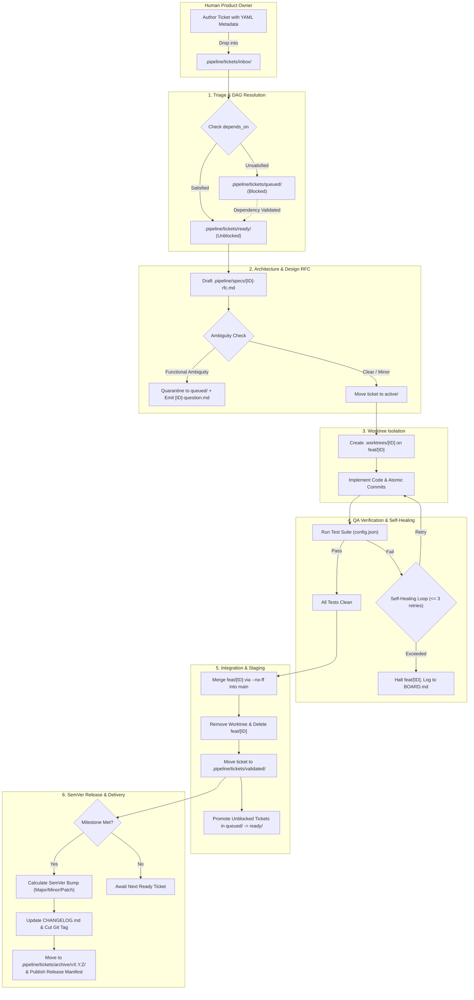

# 🚀 Continuous Autonomous Development Engine (`guidelines`)

Welcome to your central engineering orchestrator and methodology hub. This repository contains the operating rules, ticket dependency engine, and workflow guidelines for continuous, background AI software development across all your projects.

---

## 📚 Core Documents

1. **[Engineering Guidelines & Process Proposal (GUIDELINES.md)](file:///home/laurent/Dev/app-factory/guidelines/GUIDELINES.md)**
   - The complete 6-stage autonomous lifecycle (Inbox → DAG Triage → RFC Design → Worktree Dev → QA Verification → SemVer Release).
   - Detailed Git command and worktree execution runbook.
   - Token & resource budgeting rules.
   - Zero-interruption execution protocol.
   - Subagent architecture and specialized role matrix (`researcher`, `worktree-developer`, `qa-verifier`).
2. **[Agent Rules (.gemini/rules.md)](file:///home/laurent/Dev/app-factory/guidelines/.gemini/rules.md)**
   - Autonomy directives preventing permission interruptions, guaranteeing worktree isolation, and governing subagent delegation boundaries.
3. **[Standard Templates](file:///home/laurent/Dev/app-factory/guidelines/templates/)**
   - **[Ticket Template (templates/ticket.md)](file:///home/laurent/Dev/app-factory/guidelines/templates/ticket.md)**: YAML frontmatter + acceptance criteria.
   - **[Design RFC Template (templates/rfc.md)](file:///home/laurent/Dev/app-factory/guidelines/templates/rfc.md)**: Architectural specifications.
   - **[Release Template (templates/release.md)](file:///home/laurent/Dev/app-factory/guidelines/templates/release.md)**: Milestone release manifests.

---

## 🔄 Autonomous Workflow Summary

The Autonomous Continuous Development Organization (ACDO) pipeline decouples **human product definition** from **autonomous implementation**. Developers drop tickets with requirements into the pipeline, and the AI agent runs an atomic, self-healing execution loop in background isolation without disrupting active work.



### The 6 Stages at a Glance

| Stage | Name | Description | Key Artifacts & Commands |
| :--- | :--- | :--- | :--- |
| **1** | **Triage & DAG Resolution** | Scans `inbox/`, parses YAML metadata (`depends_on`), and determines ticket readiness. Blocks tickets with unmet dependencies into `queued/` and promotes ready ones to `ready/`. Updates `BOARD.md`. | Moves tickets between `inbox/`, `queued/`, and `ready/`; commits `BOARD.md`. |
| **2** | **Architecture & Design RFC** | Before writing code, drafts an RFC covering file changes, interfaces, and acceptance tests. Applies the **Ambiguity Protocol**: minor details are decided idiomatically; blocking ambiguities quarantine the ticket to `queued/` with a question RFC, allowing the agent to continue to other ready tickets without halting the sprint. | `.pipeline/specs/[ID]-rfc.md`<br>`.pipeline/specs/[ID]-question.md` (if blocked) |
| **3** | **Isolated Worktree Development** | Provisions an ephemeral Git worktree off `HEAD` into `.worktrees/[ID]` on a dedicated `feat/[ID]` branch. Protects the user's active checkout from background disruption. | `git worktree add -b feat/[ID] .worktrees/[ID] HEAD` |
| **4** | **Automated Testing & Self-Healing** | Runs automated tests, linters, and type checks configured in `config.json`. If tests fail, enters a self-healing loop (up to 3 attempts) parsing diffs and stack traces. Halts safely without merging if unresolved after 3 tries. | `npm test` / `pytest`<br>`git restore .` on failed retry |
| **5** | **Integration & Staging** | Merges the feature branch into `main` using `--no-ff` for traceable commit history. Decommissions and prunes the worktree, removes `feat/[ID]`, moves ticket to `validated/`, and promotes newly unblocked tickets in `queued/`. | `git merge --no-ff feat/[ID]`<br>`git worktree remove .worktrees/[ID]` |
| **6** | **SemVer Release & Delivery** | When a release milestone is reached, calculates the semantic version bump, updates `CHANGELOG.md`, generates a release manifest, moves tickets to `archive/vX.Y.Z/`, and creates an annotated Git tag. | `.pipeline/releases/RELEASE-vX.Y.Z.md`<br>`git tag -a vX.Y.Z` |

### Ticket State Machine Directory Structure

```
.pipeline/tickets/
├── inbox/      # Drop new feature requests or bug tickets here anytime
├── queued/     # Triaged tickets blocked by unfinished dependencies or ambiguity quarantine
├── ready/      # Unblocked tickets prioritized and ready for autonomous execution
├── active/     # Currently under active development or QA testing in a worktree
├── validated/  # Merged into main, verified passing all tests and quality gates
└── archive/    # Completed tickets grouped by release milestone (e.g. archive/v1.0.0/)
```

---

## ⚡ Quick Start: Adding a Pipeline to Any Project

To enable continuous autonomous engineering on an existing or new project (e.g. `kan-shooter`, `landscaper`):

### Automated Setup via `init-pipeline.sh`

The initialization script supports both **Project-level** and **Global** discovery modes via CLI flags:

```bash
# Option 1: Standard project setup (creates AGENTS.md / GEMINI.md in project root)
/home/laurent/Dev/app-factory/guidelines/scripts/init-pipeline.sh /path/to/my-project [project-name]

# Option 2: Full setup with both Project-level AGENTS.md and Global ~/.gemini/config/rules/acdo.md
/home/laurent/Dev/app-factory/guidelines/scripts/init-pipeline.sh --both /path/to/my-project [project-name]

# Option 3: Install/update Global Antigravity rule only (applies to all .pipeline/ repos)
/home/laurent/Dev/app-factory/guidelines/scripts/init-pipeline.sh --global
```

#### Script Flags Reference:
* `-p, --project` : Generate `AGENTS.md` and `GEMINI.md` in the project root for automatic native Antigravity discovery *(default: enabled)*.
* `-g, --global`  : Install or update the global Antigravity rule in `~/.gemini/config/rules/acdo.md`.
* `-b, --both`    : Apply both project-level directives and global rule.
* `--no-project`  : Skip generating `AGENTS.md` in the project root (when relying only on global rules).
* `-h, --help`    : Display script usage instructions.

---

### Manual Setup
1. **Initialize the `.pipeline` folder inside the project**:
   ```bash
   mkdir -p <project-root>/.pipeline/{tickets/{inbox,queued,ready,active,validated,archive},specs,releases}
   ```
2. **Add `.worktrees/` to `.gitignore`**:
   ```bash
   echo ".worktrees/" >> <project-root>/.gitignore
   ```
3. **Copy the ticket template into the inbox**:
   ```bash
   cp /home/laurent/Dev/app-factory/guidelines/templates/ticket.md <project-root>/.pipeline/tickets/inbox/FEAT-001-init.md
   ```
4. **Trigger background execution**:
   Use the `/goal` command in Antigravity:
   ```text
   /goal Process the next unblocked ticket in <project-name>/.pipeline/tickets/ready/
   ```
